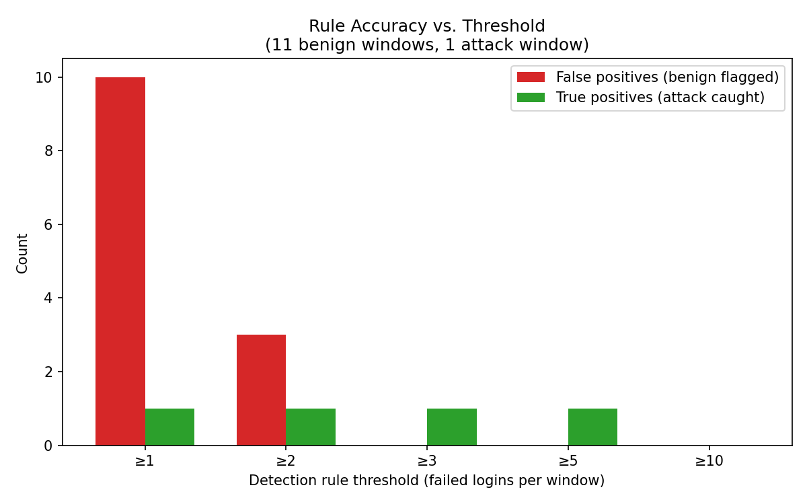

# Signal vs Noise

**Measuring alert false-positive rates in a live Splunk SIEM deployment.**

   

A hands-on lab on *alert fatigue*: SOC analysts get flooded with false positives until they start ignoring real alerts. Instead of just describing the problem, this project builds a real detection pipeline, generates real attack and benign traffic, and measures exactly where a simple brute-force detection rule turns into noise versus catching the real thing.

> 📄 **Full write-up** (methodology, results, legal considerations): [`report/Signal_vs_Noise_Research_Assignment.pdf`](report/Signal_vs_Noise_Research_Assignment.pdf)

---

## TL;DR

- Built a real **Splunk Enterprise + Universal Forwarder** pipeline, ingesting live SSH authentication logs from a Kali Linux VM.
- Generated a genuine **Hydra brute-force attack** and **11 benign login-failure windows** (mistyped passwords, abandoned attempts, typo'd usernames).
- A naive rule (flag on **any** failed login) was wrong **91%** of the time.
- Threshold **≥3 failed attempts per minute** eliminated every false positive in the dataset while still catching the real attack.

| Threshold | False positives (of 11 benign windows) | Attack detected? |
|---|---|---|
| ≥ 1 | 10 (91%) | ✅ Yes |
| ≥ 2 | 3 (27%) | ✅ Yes |
| **≥ 3** | **0 (0%)** | ✅ **Yes** |
| ≥ 10 | 0 (0%) | ❌ No (missed) |

**Takeaway:** too low means noise, too high means missed attacks. ≥3 was the best balance in this dataset.



---

## Why this project

Most SOC/SIEM tutorials stop at "install the tool, trigger one alert, done." This project asks a sharper question: **how noisy is a detection rule, and what does it take to fix that?** That is daily work for a detection engineer: testing a rule against both malicious and benign data before trusting it.

---

## Detection

```spl
index=* host=kali "Failed password"
| rex "from (?<src_ip>\d+\.\d+\.\d+\.\d+)"
| bin _time span=1m
| stats count by src_ip, _time
| where count >= 3
```

Counts failed SSH logins per source IP in 1-minute windows and flags windows with 3 or more.

- All queries (including a failures-then-success correlation variant): [`detection/failed_login_detection.spl`](detection/failed_login_detection.spl)
- Portable rule: [`detection/brute_force_ssh.sigma.yml`](detection/brute_force_ssh.sigma.yml)

**MITRE ATT&CK:** T1110 Brute Force (T1110.001 Password Guessing)

---

## Lab architecture

```
┌──────────────────────────┐            ┌──────────────────────────┐
│  Kali Linux VM           │            │  Host machine            │
│  (attacker + victim)     │   :9997    │  Splunk Enterprise       │
│  Splunk Universal        │ ────────▶ │  (indexer + dashboard)   │
│  Forwarder → auth.log    │            │  http://localhost:8000   │
└──────────────────────────┘            └──────────────────────────┘
```

Attacker and victim traffic both used the loopback interface (`127.0.0.1`) on a single Kali VM. This was a deliberate scoping decision that still produces authentic `sshd` logs. See **Limitations** below.

---

## Method

1. **Attack traffic:** [Hydra](https://github.com/vanhauser-thc/thc-hydra) brute-forced a dedicated low-privilege test account (`testvictim`) over SSH, using wordlists of varying size.
2. **Benign traffic:** manually generated realistic login failures (single mistyped passwords, forgetful multi-attempt logins, typo'd usernames) to mimic genuine human error.
3. **Detection:** an SPL query aggregated failed logins into 1-minute windows per source IP.
4. **Analysis:** the same aggregation was tested at thresholds of 1, 2, 3, 5, and 10 to find where false positives disappeared without losing the real attack.

Full methodology, raw data tables, and discussion are in the report.

---

## Key finding

A single-failure threshold, the most "cautious" rule, is the **worst** choice: it produced a 10:1 noise-to-signal ratio, which in a real SOC would train analysts to ignore the alert entirely. One evidence-based tuning step (≥3 instead of ≥1) removed all observed noise with no loss of detection. Detection rules need testing, not just deployment.

---

## Limitations

- **Small sample:** 11 benign windows, so rates are indicative, not statistically conclusive.
- **Single source IP (loopback):** multi-source or distributed attacks are untested.
- **Simulated benign traffic:** manually generated, not real user behavior.
- **Fixed 1-minute window:** "low and slow" attacks would evade it.

**Next steps:** more benign data, multi-source attacks, longer time windows, per-user aggregation.

---

## Reproduce

1. Install Splunk Enterprise on the host and enable receiving on port 9997.
2. Install Splunk Universal Forwarder 10.6.0.5 on Kali and run `scripts/setup_forwarder.sh` (monitors `/var/log/auth.log`).
3. Run the traffic steps in `scripts/run_trials.sh`.
4. Run the queries in `detection/failed_login_detection.spl` and compare alert counts at each threshold.
5. Run `python scripts/generate_charts.py` to rebuild the charts.

---

## Repo structure

```
.
├── report/                  Full research write-up (PDF + Word), charts
├── lab/
│   └── screenshots/         Evidence from every stage of the build
├── detection/
│   ├── failed_login_detection.spl   Splunk SPL queries
│   └── brute_force_ssh.sigma.yml    Portable Sigma detection rule
└── scripts/
    ├── setup_forwarder.sh   Universal Forwarder install/config
    ├── run_trials.sh        Attack + benign traffic generation
    └── generate_charts.py   Builds the charts from lab data
```

---

## Tools used

`Splunk Enterprise` · `Splunk Universal Forwarder 10.6.0.5` · `Kali Linux` · `Hydra` · `VirtualBox` · `Python (matplotlib)`

---

## Ethics

All attacks were run against my own isolated lab systems using a dedicated test account.

---

## Author

**Syed Zabiullah Mehdi**, B.Tech Computer Science (Cyber Security)
Built as part of a college research assignment on cybercrime and digital forensics, and expanded for portfolio use.
